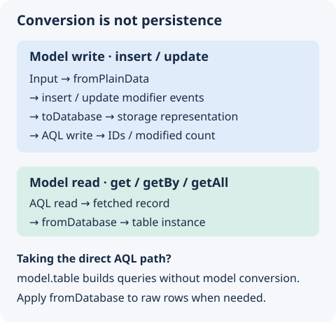

A data model reads and writes one table. It converts between stored records and instances of the table class, and has methods for the common CRUD operations.

## `BasicDataModel`

The `BasicDataModel` function creates a model class for a table. The class wraps the AQL table with methods that apply the modifier transformations.

```typescript fragment
import { BasicDataModel } from "@antelopejs/interface-database-decorators";
import { User } from "./user.table";

const UserModel = BasicDataModel(User, "users");
```

### Parameters

| Parameter   | Type               | Description                                                             |
| ----------- | ------------------ | ----------------------------------------------------------------------- |
| `dataType`  | `Constructible<T>` | The table class.                                                        |
| `tableName` | `string`           | The table name in the database. Optional when `@RegisterTable` sets it. |

When the table class has `@RegisterTable`, you can omit `tableName`. Without either, `BasicDataModel` throws `tableName must be provided or set via @RegisterTable`.

## Instantiate a model

A model instance needs a `SchemaInstance` from the database interface:

```typescript fragment
import { Schema } from "@antelopejs/interface-database";

const schema = Schema.get("myapp");
if (!schema) throw new Error("Schema myapp is not registered");
const db = schema.instance();

const userModel = new UserModel(db);
```

## Read and write rows

For a model created with `BasicDataModel(User)`, the return values are:

| Method                               | Declared return                  | Meaning                                                             |
| ------------------------------------ | -------------------------------- | ------------------------------------------------------------------- |
| `get(id)`                            | `PromiseLike<User \| undefined>` | The converted row, or `undefined` when the provider returns no row. |
| `getBy(index, ...keys)` / `getAll()` | `PromiseLike<User[]>`            | Converted rows, not an AQL query to chain.                          |
| `insert(data, options?)`             | `Promise<string[]>`              | Inserted document IDs.                                              |
| `update(...)`                        | `Promise<number>`                | Number of modified documents.                                       |
| `delete(id)`                         | `Promise<number>`                | Number of deleted documents.                                        |

Use `model.table` to compose an AQL query before you run it. The static `fromDatabase()` conversion returns `undefined` when the record is `null` or `undefined`, as `table.get` gives for a missing ID. The static `toDatabase()` returns a `StoredRow<T>`, the record to store, not a saved record or a write result.

### Read

```typescript fragment
// Get by primary key
const user = await userModel.get("user-123");

// Get by secondary index
const admins = await userModel.getBy("role", "admin");

// Get all documents
const allUsers = await userModel.getAll();
```

### Create

```typescript fragment
// Insert a single document
const ids = await userModel.insert({
  email: "alice@example.com",
  name: "Alice",
});

// Insert multiple documents
const batchIds = await userModel.insert([
  { email: "bob@example.com", name: "Bob" },
  { email: "carol@example.com", name: "Carol" },
]);
```

### Update

```typescript fragment
// Update by ID
await userModel.update("user-123", { name: "Updated Name" });

// Update by including the primary key in the object
await userModel.update({ _id: "user-123", name: "Updated Name" });
```

When you call `update` without a separate ID argument, the object must include the primary key. Its type requires `_id`, and a call without it throws `Missing primary key in object update.`

### Delete

```typescript fragment
await userModel.delete("user-123");
```

## Data conversion

A model class has static methods that convert between the forms of a row:

| Starting value          | Conversion      | Result                                            | Persists data? |
| ----------------------- | --------------- | ------------------------------------------------- | -------------- |
| Plain application input | `fromPlainData` | Table instance with input modifier events applied | No             |
| Raw database record     | `fromDatabase`  | Table instance with read modifier events applied  | No             |
| Table instance          | `toDatabase`    | Plain storage representation                      | No             |

Use `insert` or `update` to write. A conversion alone saves nothing. Reads through `get`, `getBy`, and `getAll` apply `fromDatabase` for you. A custom query through `model.table` returns AQL results, so apply conversion explicitly when you need model instances.

{width="480"}

### `fromPlainData(obj)`

Converts a plain JavaScript object into an instance of the table class. Each key is assigned, so modifiers such as encryption and hashing transform the values during this conversion. An instance of the table class is returned as it is.

```typescript fragment
const user = UserModel.fromPlainData({
  _id: "user-123",
  email: "user@example.com",
  name: "John",
});
```

The object is a `PlainData<T>`. Every field is optional and may be partial, and a field under a container modifier may hold its value per key, as a localized field holds one text per locale. `toPlainData` gives the reverse form, a `PlainRow<T>`.

### `fromDatabase(obj)`

Converts a stored record into an instance of the table class. It copies the record, sets the class prototype on the copy, and triggers the `fromDatabase` modifier event. It returns `undefined` when the record is `null` or `undefined`, as `table.get` gives for a missing ID. An empty object still gives an instance.

```typescript fragment
const user = UserModel.fromDatabase(rawDbRecord);
```

### `toDatabase(obj)`

Converts an instance of the table class, or plain data, into the record to store, and triggers the `toDatabase` modifier event. The result is a `StoredRow<T>`. It holds the fields that are set, has no prototype, and keeps its modified fields locked in `_internal` instead of at the top level.

```typescript fragment
const dbReady = UserModel.toDatabase(userInstance);
```

## Validation

`Model.validate(obj)` runs every io-ts codec that `@Field` attached against the matching property of `obj`. It skips string-token fields and properties without `@Field`. A failure's `message` is the first message the codec reports, or `invalid <field>` when the codec reports none, as io-ts's built-in codecs do.

```typescript fragment
const result = UserModel.validate({ name: "Alice", age: 30 });
if (!result.ok) {
  console.error(result.errors); // [{ field: "age", message: "invalid age" }]
}
```

Pass `{ validate: true }` to `insert` or `update` to validate before the write. On failure the call throws an `Error` with the message `validation failed: <field> (<message>), ...` and an `errors` property that holds the details per field. On success the write goes on with the object unchanged.

```typescript fragment
await userModel.insert({ name: "Alice", age: 30 }, { validate: true });
await userModel.update("user-123", { name: "Bob" }, { validate: true });
```

`insert` validates every codec field of each row. `update` validates only the fields present on the patch object, so you can leave out the fields you do not change. For the same patch check outside `update`, use `Model.validate(obj, { partial: true })`.

## Extend `BasicDataModel`

Extend the generated model class to add custom query methods.

The `register` method below checks for an existing email to report a duplicate early. It does not guarantee uniqueness under concurrent writes. Enforce that constraint in the database with a unique index where the database module supports it, and handle the conflict. `findActive` converts each row with `fromDatabase`, which returns `undefined` only when the record is `null` or `undefined`, and the filter drops a missing row.

```typescript fragment
const UserModelBase = BasicDataModel(User, "users");

class CustomUserModel extends UserModelBase {
  async findActive() {
    return this.table
      .filter((u) => u.key("status").eq("active"))
      .then((rows) =>
        rows
          .map((row) => CustomUserModel.fromDatabase(row))
          .filter((user) => user !== undefined),
      );
  }

  async register(email: string, name: string) {
    const existing = await this.getBy("email", email);
    if (existing.length > 0) {
      throw new Error("Email already in use");
    }
    return this.insert({ email, name, status: "active" });
  }
}
```

## `GetModel`

The `GetModel` function returns the cached model instance for a model class and an instance ID, and creates it on the first call:

```typescript fragment
import { GetModel } from "@antelopejs/interface-database-decorators";

const userModel = GetModel(UserModel, "instance-id");
```

The cache key is the class and the instance ID, so repeated calls with the same arguments return the same instance. Without an instance ID, the model uses the default instance. A model built by `BasicDataModel` uses the schema that `RegisterSchema` bound its table class to, so it stays on the declaring module's database even when another module calls `GetModel`. An unbound table class whose schema name has no schema throws `<Class> is not bound to a schema`. A custom model class without a `tableClass` gets its schema from its `schemaName` through `Schema.get`.

## Modifier integration

Data models apply every modifier transformation:

- On insert, the model converts the data with `fromPlainData`, fires the `insert` event, and converts the result with `toDatabase` before the write.
- On update, the model runs the same conversions with the `update` event. It leaves out an empty `_internal`, so a patch keeps what the row stores there.
- On read, the model converts the results of `get`, `getBy`, and `getAll` with `fromDatabase`.

As a result, encrypted fields are encrypted before storage and decrypted on read, hashed fields are hashed on write, and localized fields follow their locale settings.
